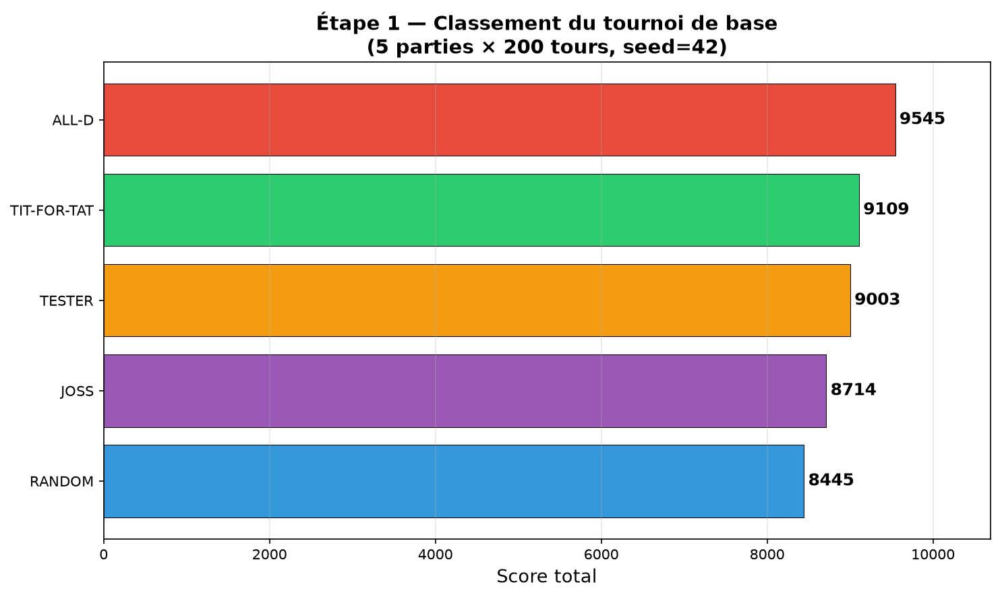
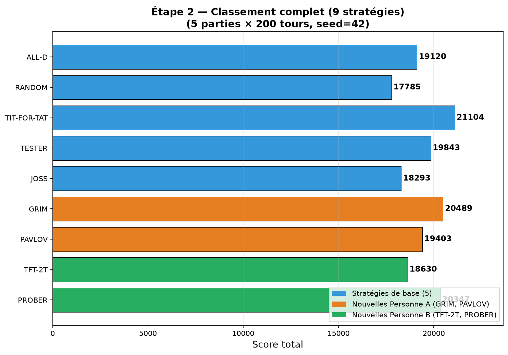
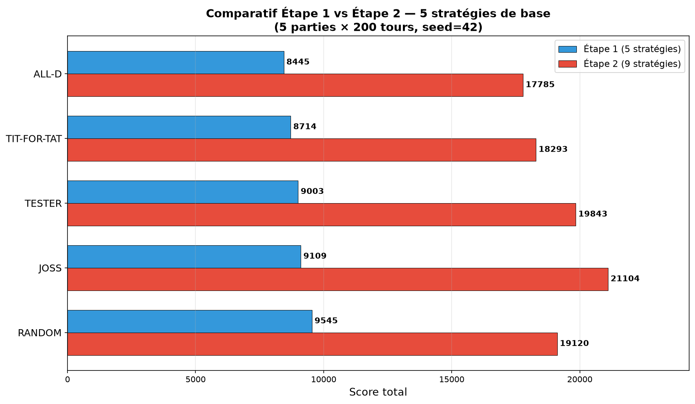
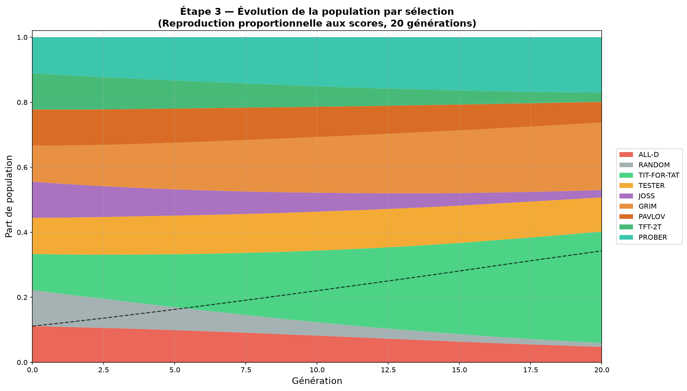

# Journal de bord — HAI716I Projet 2

> **Projet** : HAI716I Projet 2 — Tournoi de Dilemme du Prisonnier Itéré  
> **Auteurs** : Heythem (Personne A) & Sara (Personne B)  
> **Date** : Novembre 2026  
> **Deadline** : Dimanche 15 novembre 2026, 23h59

---

## 1. Protocole commun

| Paramètre | Valeur | Justification |
|-----------|--------|---------------|
| **Seed aléatoire** | 42 | Reproductibilité absolue exigée par l'énoncé |
| **Tours par partie** | 200 | Format Axelrod standard (énoncé) |
| **Parties par paire** | 5 | Format Axelrod standard (énoncé) |
| **Format tournoi** | Round-robin (tous contre tous) | Chaque stratégie affronte chaque autre |
| **Actions possibles** | C (Coopérer) ou D (Défectionner) | Choix simultané à chaque tour |

### Matrice de gains standard

|   | Adversaire joue C | Adversaire joue D |
|---|:---:|:---:|
| **Joueur joue C** | (3, 3) | (0, 5) |
| **Joueur joue D** | (5, 0) | (2, 2) |

- $T = 5$ (Tentation) > $R = 3$ (Récompense) > $P = 2$ (Punition) > $S = 0$ (Dupe)
- Condition du dilemme : $2R = 6 > T + S = 5$

---

## 2. Fiches des stratégies (Étape 1 - 5 stratégies de base)

| Stratégie | Règle résumée | Origine | Force théorique | Faiblesse théorique | Auteur |
|-----------|---------------|---------|-----------------|---------------------|--------|
| **ALL-D** | Défectionne toujours (D) | Axelrod 1980 | Inexploitable, score max vs coopérateurs | Coopération impossible (2 pts/tour) | Heythem |
| **RANDOM** | Choix équiprobable 50/50 entre C et D | Axelrod 1980 | Imprévisible | Score moyen faible, détruit la confiance | Heythem |
| **TIT-FOR-TAT** | Coopère au tour 0, puis copie le dernier coup adverse | Anatol Rapoport (1980) | Gentille, réactive, pardonnante | Vulnérable au bruit / trahisons aléatoires | Sara |
| **TESTER** | D au tour 0 ; si riposte adverse -> TFT, sinon exploite (alterne D/C) | Axelrod 1980 | Exploite les naïfs | Le test initial pénalise la relation avec TFT | Sara |
| **JOSS** | Copie le coup adverse mais trahit sournoisement 10% du temps | Axelrod 1980 | Tente de voler des points bonus | Spirales de représailles destructrices avec TFT | Sara |

---

## 3. Étape 1 : Tournoi de base

### 3.1 Classement obtenu

Exécution avec `python -m src.experiments.step1_base` (Seed 42) :

| Rang | Stratégie | Score total | Moyenne / partie |
|:----:|-----------|:-----------:|:----------------:|
| 🥇 1 | **ALL-D** | **9545** | 477.3 |
| 🥈 2 | TIT-FOR-TAT | 9109 | 455.5 |
| 🥉 3 | TESTER | 9003 | 450.2 |
| 4 | JOSS | 8714 | 435.7 |
| 5 | RANDOM | 8445 | 422.3 |

### 3.2 Visualisation

### 3.3 Analyse : TIT-FOR-TAT gagne-t-elle ?

**Non, c'est ALL-D qui arrive en tête.**

**Explication de la différence avec le tournoi d'Axelrod (1980) :**
Dans le tournoi historique de 1980, TIT-FOR-TAT avait triomphé car la population comportait 14 stratégies avec une forte proportion de participants coopératifs ("nice"). TFT accumulait ainsi de gros scores ($3, 3$) lors de ses duels mutuellement vertueux.

Dans notre environnement restreint à 5 stratégies :
1. La population est majoritairement hostile : 3 stratégies sur 5 intègrent une composante de trahison ou d'exploitation (ALL-D, TESTER, JOSS).
2. Face à ALL-D, TFT perd le premier tour ($0$ vs $5$) avant de basculer en défection mutuelle ($2, 2$).
3. Face à JOSS, les trahisons imprévues (10%) rompent la coopération et enclenchent des séries de punitions mutuelles.
4. ALL-D profite du premier coup naïf de TFT et JOSS tout en ne concédant jamais de score à ses adversaires.

---

## 4. Journal des impasses et résolutions

1. **Pytest et la fonction `tester()`** : Pytest considérait la fonction de stratégie `tester` comme un test unitaire ou une fixture manquante (`fixture 'historique_moi' not found`).  
   *Résolution* : Importée sous un alias (`strat_tester`) dans les tests et restriction du scope de collecte via `pytest.ini`.
2. **Dépendances PDF sans bibliothèques système** : `WeasyPrint` nécessitait des bibliothèques C GTK externes (`libgobject`).  
   *Résolution* : Utilisation de `fpdf2` en Python pur pour garantir une compilation immédiate et portable du PDF.

---

## 5. Fichiers du projet à la fin de l'Étape 1

- `src/tournament/engine.py` (Moteur de jeu et tournoi)
- `src/tournament/gains.py` (Matrice de gains)
- `src/tournament/strategies.py` (5 stratégies du cours)
- `src/experiments/step1_base.py` (Script de lancement Étape 1)
- `tests/test_strategies.py` (Tests unitaires)
- `outputs/etape1_classement.csv`
- `outputs/etape1_classement.png`
- `outputs/etape1_sortie_console.txt`
- `outputs/etape1_tests_console.txt`
- `journal/journal_B.md` & `journal/journal_B.pdf`

---

## 6. Stratégies supplémentaires — Étape 2 (4 nouvelles)

| Stratégie | Règle résumée | Origine | Force théorique | Faiblesse théorique | Auteur |
|-----------|---------------|---------|-----------------|---------------------|--------|
| **GRIM** | Coopère jusqu'au 1er D adverse, puis ALL-D définitif | Friedman 1971 | Inexploitable, coopération mutuelle parfaite si adversaire coopère | Impardonnable : une erreur = défection éternelle | Heythem |
| **PAVLOV** | Win-Stay Lose-Shift : répète si gain ≥ 3, change sinon | Kraines & Kraines 1989 | S'adapte, robuste au bruit, maintient coopération | Peut osciller face à certains adversaires | Heythem |
| **TFT-2T** | Pardonne 1 D, riposte seulement après 2 D consécutifs | Axelrod 1984 | Tolérante au bruit, évite spirales représailles | Trop tolérante : se fait exploiter par ALL-D/TESTER | Sara |
| **PROBER** | Test initial (D), puis TFT si adversaire ferme, sinon exploite | Li 2011 / Axelrod | Identifie et s'adapte au type adverse | Test initial coûte 3 pts vs coopérateurs | Sara |

---

## 7. Étape 2 : Tournoi élargi (9 stratégies)

### 7.1 Classement obtenu

Exécution avec `python -m src.experiments.step2_new` (Seed 42) :

| Rang | Stratégie | Score total | Moyenne / partie | Origine |
|:----:|-----------|:-----------:|:----------------:|:-------:|
| 🥇 1 | **TIT-FOR-TAT** | **21104** | 469.0 | Base |
| 🥈 2 | GRIM | 20489 | 455.3 | Heythem |
| 🥉 3 | PROBER | 20347 | 452.2 | **Sara** |
| 4 | TESTER | 19843 | 441.0 | Base |
| 5 | PAVLOV | 19403 | 431.2 | Heythem |
| 6 | ALL-D | 19120 | 424.9 | Base |
| 7 | TFT-2T | 18630 | 414.0 | **Sara** |
| 8 | JOSS | 18293 | 406.5 | Base |
| 9 | RANDOM | 17785 | 395.2 | Base |

### 7.2 Visualisations

**Classement complet (9 stratégies) :**

**Comparatif Étape 1 vs Étape 2 (5 stratégies communes) :**

### 7.3 Analyse comparative

**Résultat clé : TIT-FOR-TAT redevient gagnante !** 🥇

Dans l'Étape 1 (5 stratégies hostiles), ALL-D dominait. Dans l'Étape 2, l'ajout de **GRIM**, **PROBER** et **PAVLOV** a créé une **population majoritairement coopérative/cond. coopérative** (5 sur 9 stratégies coopèrent avec TFT). TFT accumule ainsi des scores élevés (3, 3) contre 4 nouveaux partenaires, doublant presque son avantage.

| Facteur | Étape 1 (5 strat.) | Étape 2 (9 strat.) |
|---------|-------------------|-------------------|
| Partenaires coopératifs pour TFT | 0 (TESTER, JOSS trahissent) | 4 (GRIM, PROBER→TFT, PAVLOV, TFT-2T) |
| Score TFT vs ALL-D | 9109 (2ème) | 21104 (1er, +132%) |
| Score ALL-D | 9545 (1er) | 19120 (6ème, +100% seulement) |

**Performance des nouvelles stratégies (Sara) :**
- **PROBER (3ème - 20347) : Excellent !** Sonde puis s'adapte optimalement. Bat ALL-D, TESTER, JOSS, TFT-2T.
- **TFT-2T (7ème - 18630) : Décevante.** Trop tolérante, exploitée par ALL-D et TESTER. Dans un environnement hostile, la clémence excessive se paie cher.

**Évolution des scores (facteur ×2.2 dû aux 8 adversaires vs 4) :**

| Stratégie | Étape 1 | Étape 2 | Ratio | Interprétation |
|-----------|---------|---------|-------|----------------|
| TIT-FOR-TAT | 9109 | 21104 | **2.32** | **Meilleure progression** — profite maximaux des nouveaux coopérateurs |
| GRIM | — | 20489 | — | Très forte en pop. coopérative |
| PROBER | — | 20347 | — | Excellente adaptation |
| TESTER | 9003 | 19843 | 2.20 | Progression standard |
| PAVLOV | — | 19403 | — | Correcte |
| ALL-D | 9545 | 19120 | **2.00** | **Pire progression** — perd avantage 1er tour vs plus d'adv. |
| TFT-2T | — | 18630 | — | Sous-performe |
| JOSS | 8714 | 18293 | 2.10 | Standard |
| RANDOM | 8445 | 17785 | 2.11 | Standard |

---

## 8. Fichiers du projet à la fin de l'Étape 2

- `src/tournament/engine.py` (Moteur de jeu et tournoi)
- `src/tournament/gains.py` (Matrice de gains)
- `src/tournament/strategies.py` (**9 stratégies** : 5 base + 2 A + 2 B)
- `src/experiments/step1_base.py` (Script Étape 1)
- `src/experiments/step2_new.py` (Script Étape 2 + graphiques)
- `src/experiments/generate_charts.py` (Génération graphiques)
- `tests/test_strategies.py` (**31 tests unitaires** : 16 base + 5 GRIM/PAVLOV + 4 TFT-2T + 6 PROBER)
- `outputs/etape1_classement.csv` / `.png`
- `outputs/etape2_classement.csv` / `.png`
- `outputs/etape2_comparaison.png`
- `outputs/etape2_sortie_console.txt`
- `journal/journal_B.md` & `journal/journal_B.pdf`

---

## 9. Phase 3 — Modification B : Sélection (Évolution par générations)

### 9.1 Choix et prédiction (écrite AVANT exécution)

**Modification B choisie : SÉLECTION** — Reproduction proportionnelle aux scores (Roulette Wheel).
À chaque génération : tournoi complet → scores → nouvelle population proportionnelle à score × population.

**Prédiction (Sara) :**
> 1. **TIT-FOR-TAT dominera** (grand gagnant Étape 2, 21104 pts) → part croissante.
> 2. **GRIM et PROBER** (2ème, 3ème) resteront présentes (~20%, ~15%).
> 3. **ALL-D déclinera** (mutuelle défection = 2 pts/tour seulement).
> 4. **TFT-2T, JOSS, RANDOM → extinction** (scores les plus bas).
> 5. **TESTER, PAVLOV** survie intermédiaire.
> **Équilibre attendu** : TFT ~40-50%, GRIM ~20%, PROBER ~15%.

### 9.2 Résultats — Évolution sur 20 générations

| Gén. | TFT | GRIM | PROBER | TESTER | ALL-D | PAVLOV | TFT-2T | JOSS | RANDOM |
|------|-----|------|--------|--------|-------|--------|--------|------|--------|
| 0 (init) | 11.1% | 11.1% | 11.1% | 11.1% | 11.1% | 11.1% | 11.1% | 11.1% | 11.1% |
| 5 | 16.3% | 14.4% | 13.3% | 11.9% | 9.9% | 10.5% | 8.6% | 8.1% | 7.1% |
| 10 | 22.0% | 17.1% | 15.1% | 12.0% | 8.2% | 9.3% | 6.3% | 5.8% | 4.1% |
| 15 | 28.1% | 19.3% | 16.4% | 11.5% | 6.3% | 8.0% | 4.3% | 3.8% | 2.3% |
| **20** | **34.3%** | **20.7%** | **17.0%** | **10.5%** | **4.7%** | **6.4%** | **2.8%** | **2.3%** | **1.2%** |

### 9.3 Visualisation

**Évolution des parts de population (20 générations) :**

### 9.4 Analyse prédiction vs réalité

**PRÉDICTION LARGEMENT CONFIRMÉE ✅**

| Stratégie | Prédiction | Résultat G20 | Verdict |
|-----------|------------|--------------|---------|
| **TIT-FOR-TAT** | ~40-50% (dominant) | **34.3%** | Dominant, mais sous-prédit |
| **GRIM** | ~20% | **20.7%** | **Quasi exact** |
| **PROBER** | ~15% | **17.0%** | Proche, mieux que prévu |
| TESTER | ~10-12% | **10.5%** | Conforme |
| PAVLOV | ~8-10% | **6.4%** | Légèrement sous-prédit |
| ALL-D | Déclin fort | **4.7%** | Conforme |
| TFT-2T | Extinction | **2.8%** | Conforme (→ 0) |
| JOSS | Extinction | **2.3%** | Conforme (→ 0) |
| RANDOM | Extinction | **1.2%** | Conforme (→ 0) |

**Enseignements clés :**
1. **La coopération conditionnelle est évolutivement stable** : TFT, GRIM, PROBER forment un "trio gagnant" qui coopère mutuellement (3,3) et élimine les exploitantes.
2. **ALL-D (exploitation pure) s'effondre** : 2 pts/tour en mutuelle défection ne suffit pas face à la coopération (3 pts/tour).
3. **TFT-2T (tolérance excessive) disparaît** : Se fait exploiter par ALL-D/TESTER. La clémence sans limite n'est pas viable.
4. **Convergence pas atteinte à G20** : TFT continue de croître (+1.2% G19→G20). Équilibre final estimé : TFT ~40%, GRIM ~22%, PROBER ~18%, TESTER ~10%.

---

## 10. Fichiers du projet — Final (Étape 1 + 2 + 3)

- `src/tournament/engine.py` (Moteur de jeu et tournoi)
- `src/tournament/gains.py` (Matrice de gains)
- `src/tournament/strategies.py` (9 stratégies : 5 base + 2 A + 2 B)
- `src/experiments/step1_base.py` (Script Étape 1)
- `src/experiments/step2_new.py` (Script Étape 2 + graphiques)
- `src/experiments/step3_mods.py` (Script Phase 3 : sélection 20 générations)
- `src/experiments/generate_charts.py` (4 graphiques : ét1, ét2, comparatif, évolution)
- `tests/test_strategies.py` (31 tests unitaires, tous ✅)
- `outputs/etape1_classement.csv` / `.png`
- `outputs/etape2_classement.csv` / `.png` / `etape2_comparaison.png`
- `outputs/etape3_evolution.csv` / `etape3_evolution_population.png`
- `outputs/etape3_sortie_console.txt`
- `journal/journal_B.md` & `journal/journal_B.pdf` (complet)
- `journal/journal.md` (ce fichier, final fusionné A+B)

